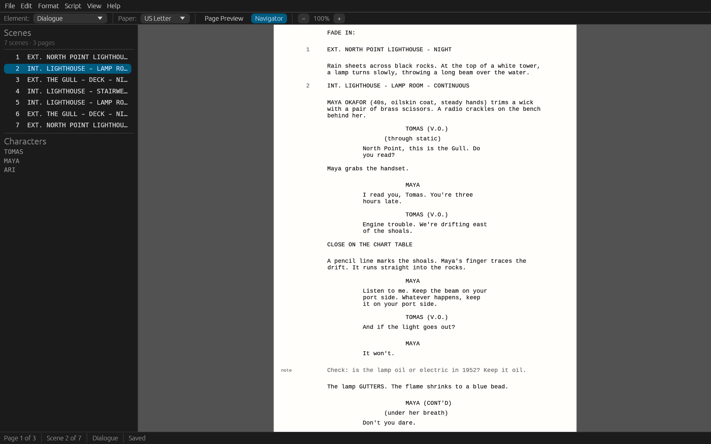
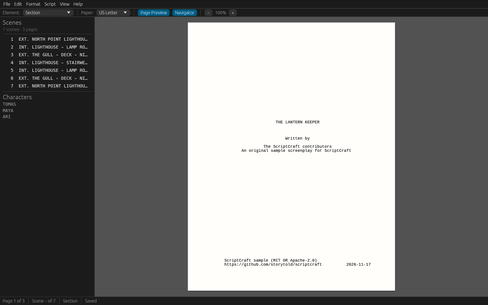

<p align="center">
  
</p>

<h1 align="center">ScriptCraft</h1>

<p align="center">
  <b>Screenwriting; an open-source screenplay editor, built in pure Rust.</b>
</p>

<p align="center">
  Write screenplays with industry-standard formatting and pagination: scene headings, action,
  characters, parentheticals, dialogue, transitions and shots, laid out on US Letter or A4 in 12 pt
  fixed-pitch type. Opens and saves Fountain (<code>.fountain</code>), opens FDX files, and hands
  scenes to BoardCraft for storyboarding. Part of the Crafting Apps film pipeline:
  ScriptCraft → BoardCraft → FilmCraft.
</p>

<p align="center">
  
  
  
</p>

<p align="center">
  
</p>

<p align="center">
  <a href="#what-works-today">What works</a> ·
  <a href="#getting-started">Getting started</a> ·
  <a href="#command-line-and-agents">Command line</a> ·
  <a href="#roadmap">Roadmap</a> ·
  <a href="#contributing">Contributing</a>
</p>

## What works today

- **Screenplay elements:** scene heading, action, character, parenthetical, dialogue, transition,
  shot, centered text, lyrics, plus outline sections, synopses, notes and omitted text that are
  kept but not printed; a title page.
- **Typing:** Enter starts the element that usually follows (character → dialogue, dialogue →
  action, transition → scene heading…); Tab and Shift+Tab change the element; Backspace at the
  start of an element joins it to the one above; ↑/↓ move between elements. Headings, character
  cues and transitions are capitalised as you type. [All keys](docs/keyboard.md).
- **Auto-complete:** character names (most frequent first), scene heading prefixes, places
  already used and times of day, and transitions.
- **Formatting and pagination:** conventional spec-script indents, 54 lines per page on US Letter
  and 58 on A4, scene headings and character cues kept with what follows, action and dialogue
  split across pages with `(MORE)` and `(CONT'D)`, page numbers, optional scene numbers in both
  margins. Page boundaries show as rules in the editor; **Page Preview** shows the exact pages.
  [Rules and measurements](docs/formatting.md).
- **Scene navigator:** every scene with its number, page and length in eighths; click to jump.
  The cast list sits beneath.
- **Files:** open and save Fountain with a lossless round trip for everything ScriptCraft reads
  ([details](docs/fountain.md)); open FDX files (elements, scene numbers, dual dialogue, title
  page); saves are atomic (a failed save never damages the old file); drop a file on the window to
  open it.
- **For BoardCraft:** *File ▸ Export Scene List for Storyboards* writes a versioned JSON scene list
  (numbers, headings split into interior/exterior, location and time, pages, eighths, characters,
  action text, beats). *Script ▸ Add Stable Scene IDs* tags scenes so storyboards can be updated
  on re-import. [The contract](docs/interop.md).
- **Plain-text export** of the paginated script.

- **Accessible and translatable:** every control and script line has an accessible name, element
  changes are announced, and the page preview publishes its text; keyboard flows are tested with
  egui_kittest's accessibility check. Interface text goes through craft-i18n (catalogs from
  `CRAFT_I18N_DIR`; View ▸ Language).

Not yet: PDF export, FDX saving, revisions and colored pages, script notes, reports, dual dialogue
side by side, translated catalogs. See the [roadmap](ROADMAP.md).

<p align="center">
  
</p>

## Getting started

Requires Rust 1.95 or newer.

```sh
git clone https://github.com/storytold/scriptcraft
cd scriptcraft
cargo run -p scriptcraft -- --sample          # open the bundled sample script
cargo test                                    # all tests; no display needed
```

Translations come from [craft-i18n](https://github.com/storytold/craft-i18n) the same way
(`CRAFT_I18N_DIR=$PWD/../craft-i18n`); without it the interface is English.

Scripts are set in Liberation Mono (SIL OFL 1.1) from
[craft-fonts](https://github.com/storytold/craft-fonts) when you build with a checkout of it;
without one, egui's built-in monospace face is used and pagination is unchanged:

```sh
git clone https://github.com/storytold/craft-fonts ../craft-fonts
CRAFT_FONTS_DIR="$PWD/../craft-fonts" cargo run -p scriptcraft -- --sample
```

`scriptcraft --help` lists the options (`--preview`, `--paper a4`, `--screenshot <file.png>`…).

## Command line and agents

Every menu action is a command with a stable id (`file.save`, `element.character`,
`file.export_scene_list`…). `scriptcraft-cli` works without a window:

```sh
scriptcraft-cli scenes script.fountain --out script.scenes.json   # scene list for BoardCraft
scriptcraft-cli convert draft.fdx draft.fountain                  # FDX → Fountain
scriptcraft-cli pages script.fountain --paper a4 --scene-numbers  # paginated plain text
scriptcraft-cli stats script.fountain                             # pages, scenes, speeches
scriptcraft-cli commands                                          # command ids and labels
```

## Architecture

| Crate | What it does | UI? |
|---|---|---|
| `scriptcraft-model` | Screenplay, elements, title page | no |
| `scriptcraft-fountain` | Fountain reader and writer | no |
| `scriptcraft-fdx` | FDX import (via craft-libs `craft-xml`) | no |
| `scriptcraft-layout` | Formatting, word wrap, pagination, plain-text pages | no |
| `scriptcraft-interchange` | Scene list for BoardCraft (JSON) | no |
| `scriptcraft-engine` | Document, undo, Enter/Tab rules, auto-complete, commands, file I/O | no |
| `scriptcraft-fonts` | Liberation Mono from craft-fonts (`CRAFT_FONTS_DIR`) | no |
| `scriptcraft-ui-egui` | Editor, page preview, navigator, dialogs | egui |
| `apps/scriptcraft`, `apps/scriptcraft-cli` | Desktop app and command-line tool | |

More in [docs/architecture.md](docs/architecture.md).

## Roadmap

ScriptCraft is a **skeleton**: the core works end to end and is tested, the shell is minimal.
[ROADMAP.md](ROADMAP.md) has the stage and next steps; [docs/gaps.md](docs/gaps.md) the ranked
work list.

## Contributing

Read [AGENTS.md](AGENTS.md) first: the Craft house rules, never crash, clean room, layering,
assets. Run `cargo xtask ci` before every pull request.

## License

Code: [MIT](LICENSE-MIT) OR [Apache-2.0](LICENSE-APACHE), at your option. Third-party material is
listed in [NOTICE](NOTICE) and [ATTRIBUTION.md](ATTRIBUTION.md).
